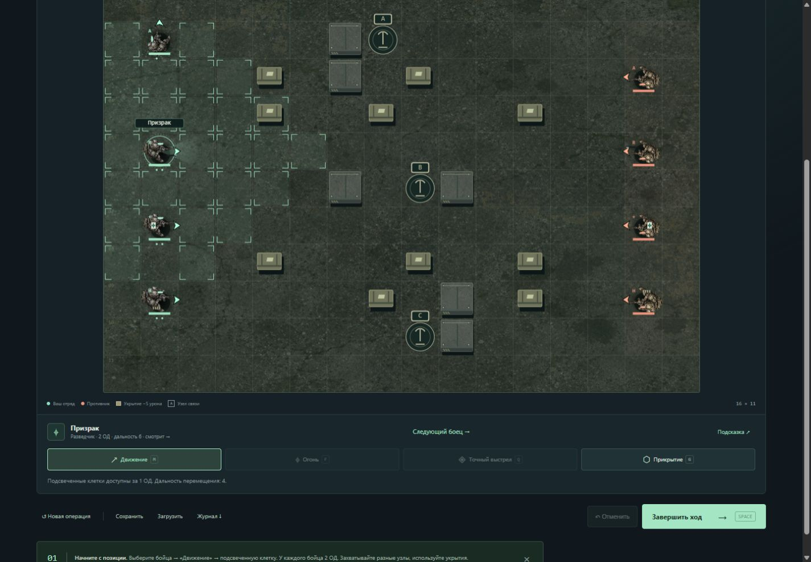

# RIFT — Линия разлома

Самостоятельная улучшенная копия исходного Battle Simulator. Вместо отдельных разговоров юнитов — тактическая операция с ясной целью, управлением отрядом и проверяемыми приказами нейросети.



**Python 3.10+ · без сторонних библиотек для игры · Windows / Linux / macOS**

[English quick guide](docs/README.en.md) · [Разработка](CONTRIBUTING.md) · [Публикация на GitHub](docs/GITHUB.md) · [Изменения](CHANGELOG.md)

## Запуск

Дважды нажмите **START_GAME.bat** (или ярлык **Играть в RIFT** в корневой папке), затем **«В бой»**. Игра откроется в браузере, консоль держать открытой не нужно. Повторный запуск откроет уже работающий сеанс, без второго сервера. Для остановки сервера нажмите **«Выйти» → «Закрыть игру»**. Закрытие одной вкладки оставляет сервер работать до выхода из игры или завершения Windows. Нужен Python 3.10 или новее. Устанавливать библиотеки не требуется.

Или из этой папки:

```powershell
python start.py
```

На Linux/macOS: `python3 start.py` или `sh START_GAME.sh`. В свежей копии включён встроенный командир: Ollama и ключи для первого запуска не нужны. При выборе провайдера через интерфейс `config.json` создаётся автоматически. Для ручной настройки можно скопировать `config.example.json` в `config.json`.

По умолчанию адрес — http://127.0.0.1:8765. Если порт занят, сервер попробует следующие девять. Другой порт: `python start.py --port 8800`. Запуск без открытия браузера: `python start.py --no-browser`.

## Визуал и удобство

- Растровый солдат с детальной бронёй и оружием, текстура бетона, тени и обозначения классов.
- Направление корпуса, ствол и стрелка показывают, куда смотрит юнит. Направление меняется при движении, атаке, лечении и ответном огне, сохраняется и отменяется вместе с действием. Оно не ограничивает обзор или стрельбу.
- «Крупная карта» освобождает место для поля; «Следующий боец» выбирает бойца с оставшимися ОД.
- Карта, сложность и режим скрыты под «Настроить…», можно сразу начать бой или продолжить сохранение.
- Растровые ресурсы локальные, интернет для игры не нужен. [Происхождение и prompts](docs/ART.md).

## Что изменилось

- Три карты с разными проходами и укрытиями; четыре класса в каждом отряде.
- Игра за командира: выбор бойца, движение, огонь, способности, прикрытие и завершение хода.
- Захват узлов A/B/C, очки контроля, победа по счёту или уничтожению отряда, предел 18 раундов.
- Стены блокируют движение и стрельбу; укрытия уменьшают урон; урон предсказуемый, без случайных промахов.
- Граната штурмовика, точный выстрел разведчика, лечение медика и подавление тяжёлого бойца.
- Прикрытие: снижение урона и один ответный выстрел при движении врага.
- Подсветка доступных действий, маршрут движения, предварительный урон, совет, отмена действий своего хода.
- Понятный журнал игровых событий, анимации, включаемый звук, клавиатура и адаптивный интерфейс.
- Ручное сохранение, отдельное автосохранение, экспорт журнала JSON.
- Наблюдение за автоматическим боем и автопилот на один ход в ручном режиме.

## Правила

У каждого бойца 2 очка действия (ОД) в начале своего хода. Перемещение и обычная атака стоят 1 ОД. Расстояния считаются по клеткам по горизонтали и вертикали. Перемещение ищет свободный путь, учитывая стены и других бойцов. Для выстрела нужна свободная линия огня.

| Класс | HP | Урон | Дальность | Движение | Способность |
|---|---:|---:|---:|---:|---|
| Штурмовик | 90 | 20 | 4 | 3 | Граната: 24 базового урона врагам в клетке и четырёх соседних, бросок до 4 клеток, 1 ОД; игнорирует укрытие |
| Разведчик | 70 | 23 | 6 | 4 | Точный выстрел: 35 урона, игнорирует укрытие, 2 ОД |
| Медик | 75 | 15 | 4 | 3 | Лечение: до +28 HP себе или союзнику до 3 клеток, 1 ОД |
| Тяжёлый боец | 115 | 26 | 4 | 2 | Подавление: 18 урона и −1 ОД следующего хода цели, 1 ОД |

После способности она недоступна два следующих своих хода. Укрытие снижает урон на 5, прикрытие — ещё на 7. Прикрытие расходует оставшиеся ОД; защита и один ответный выстрел действуют до начала следующего своего хода. Дружественного огня нет. Статистика отрядов одинакова. Сложность меняет решения противника, без скрытого увеличения здоровья или урона.

Для захвата узла нужен живой боец на самом узле или в одной соседней клетке. Если рядом оба отряда, узел спорный и очков не даёт. Без бойцов владение сохраняется. Очки начисляются после хода противника: +5 за каждый принадлежащий отряду неспорный узел. Цель — минимум 60 очков. При одновременном достижении цели решает больший счёт, затем суммарное HP; возможна ничья. На 18-м раунде используется тот же способ сравнения. Уничтожение всех бойцов немедленно завершает бой.

| Клавиша | Действие |
|---|---|
| 1–4 | Выбор своего бойца |
| M / F / Q / G | Движение / огонь / способность / прикрытие |
| Space | Завершить ход |
| Esc | Сбросить выбранное действие |
| Стрелки и Enter на карте | Выбор клетки и выполнение действия |

«Подсказка» только предлагает действие. «Автопилот на один ход» выполняет оставшиеся действия и передаёт ход противнику. В режиме наблюдения ваш отряд ведёт встроенный командир, противника — выбранный провайдер; открытое меню приостанавливает начало следующего автоматического раунда.

Наблюдение можно поставить на паузу кнопкой или клавишей **P**. Уже начатый ход противника завершится, следующий автоматический раунд подождёт. Скрытая вкладка также не запускает следующие автоматические ходы. Кнопка «Отменить» доступна до передачи хода противнику, в том числе после собственного победного действия.

## Замена нейросети

В игре откройте **Командир**. Выберите провайдера, укажите адрес сервера и имя модели. «Проверить модель» отправляет настоящий запрос с ситуацией на поле и проверяет ответ, не меняя сохранённые настройки. «Сохранить настройки» применяет выбор со следующего хода. Уже запущенный запрос использует предыдущие настройки.

**Ollama:** адрес `http://127.0.0.1:11434`, модель — точное имя из `ollama list`. Кнопка «Найти модели» получает список уже установленных моделей. Модели автоматически не скачиваются. Адаптер проверен с `gemma4:e4b`; на другом компьютере нужную модель следует установить самостоятельно.

**Совместимый API:** например, адрес `http://127.0.0.1:1234/v1` для локального сервера. Игра добавляет `/chat/completions`. Укажите точное имя модели, ожидаемое сервером. Ключ можно ввести в интерфейсе: он хранится только в памяти процесса до закрытия сервера и не попадает в конфигурацию, сохранения и экспорт. Альтернатива — переменная окружения:

```powershell
$env:BATTLE_API_KEY = 'ваш-ключ'
python start.py
```

Совместимый сервер должен поддерживать Chat Completions с `messages` и обычным ответом `choices[0].message.content`. Если он не поддерживает JSON-режим, снимите «Структурированный JSON»: требования к содержимому ответа сохранятся. Совместимость с конкретным внешним сервисом зависит от его API и выбранной модели.

**Без модели:** выберите «Встроенный тактический ИИ». Он работает без Ollama, подключения к интернету и ключей. При недоступности нейросети, ошибке JSON или тайм-ауте включается тот же резервный командир. Кнопка «Продолжить без ожидания» завершает текущий ход без ожидания ответа; пришедший позже ответ не может изменить бой. Пока прежний запрос ещё завершается, новые сетевые запросы не запускаются.

Настройки также доступны в `config.json` (при ручном редактировании перезапустите сервер):

```json
{
  "provider": "ollama",
  "base_url": "http://127.0.0.1:11434",
  "model": "gemma4:e4b",
  "api_key_env": "BATTLE_API_KEY",
  "timeout": 40,
  "structured": true,
  "thinking": false
}
```

Значения `provider`: `builtin`, `ollama`, `openai`. Тайм-аут: 5–120 секунд. `thinking` передаётся только Ollama; модели, которым обязательно нужно рассуждение, могут требовать `true` и большего тайм-аута. Не вставляйте секреты в `base_url` или `config.json`.

Протоколы реализованы по [документации структурированных ответов Ollama](https://github.com/ollama/ollama/blob/main/docs/capabilities/structured-outputs.mdx) и [справке Chat Completions](https://developers.openai.com/api/reference/resources/chat/subresources/completions/methods/create).

## Как устроен ИИ

Один запрос на весь ход противника. Модель получает ограниченный снимок текущего боя, характеристики, правила и JSON-схему. Она выбирает стратегическую цель каждому бойцу:

```json
{"orders":[{"unit":"r1","intent":"capture","target":"A"}]}
```

Приказы: `capture` (узел A/B/C), `fight` (живой враг), `support` (живой союзник), `hold` (своя позиция). Пропущенные бойцы получают встроенный план. Неверные цели, чужие или повторяющиеся бойцы и произвольные действия отклоняются. Речь модели и рассуждения не показываются игроку; журнал формируется только из игровых событий.

Исполнитель преобразует намерения в доступные действия и повторно проверяет каждое на реальном состоянии поля. Модель не меняет здоровье, координаты, счёт, файлы или правила и не выполняет команды системы. Новый провайдер подключается реализацией `Commander.plan(battle, team)` в `game/commanders.py`; движок и интерфейс менять не требуется.

## Сохранения и файлы

- `start.py` — локальный сервер и управление сеансом.
- `game/engine.py` — правила, юниты, карта, проверка действий и сохранений.
- `game/commanders.py` — провайдеры, проверка планов, встроенная тактика.
- `game/storage.py` — атомарная запись и проверка чтения файлов JSON.
- `web/` — интерфейс и карта Canvas; все ресурсы локальные.
- `savegame.json` — ручное сохранение по кнопке «Сохранить».
- `autosave.json` — последнее автоматическое сохранение; новая операция заменяет его, сохраняя ручной слот.
- «Загрузить» восстанавливает ручной слот, при его отсутствии — автоматический. «Продолжить сохранённую операцию» в стартовом брифинге предпочитает автосохранение.
- `original/` — локальная архивная копия исходной игры, если она присутствует; исключена из Git и релизного архива.
- `evidence/` — локальные результаты проверок и логи, исключённые из Git и релиза. Публичный снимок интерфейса лежит в `docs/screenshots/`.
- `tools/build_release.py` — сборка чистого архива исходников в `dist/` с SHA-256.

Настройки и сохранения по умолчанию лежат рядом со `start.py` и исключены из Git. Отдельный профиль можно запустить так: `python start.py --data-dir .local/profile-a --port 8800`. Это удобно для независимых сеансов и проверки игры, сохраняя основной профиль.

Сервер слушает только `127.0.0.1`. Это локальная игра с одним общим сеансом на процесс; несколько вкладок показывают один и тот же бой. Начатый сетевой запрос не обрывается физически, но его результат можно отменить и продолжить играть. Экспорт JSON содержит состояние, события и действия боя; это журнал для анализа, не видеоповтор.

## Проверки

```powershell
python -X utf8 -m unittest discover -s tests -v
npm run check
npm test
```

Node нужен только для проверок JavaScript, для игры он не требуется. У `npm test` нет сторонних зависимостей, `npm install` для него не нужен. Python-тесты проверяют боевые правила, случайные последовательности доступных действий, полные воспроизводимые матчи, сохранения, HTTP API, секреты, ошибки провайдера, гонки при отмене запросов и состав релизного архива. Работают без установленной нейросети и сторонних библиотек.

GitHub Actions настроен на Python 3.10, 3.12 и 3.14 на Windows/Linux, проверку формата Python и регрессионные проверки JavaScript. Подробности — в [CONTRIBUTING.md](CONTRIBUTING.md).

Лицензия пока не выбрана владельцем проекта; файл LICENSE не добавлен.
